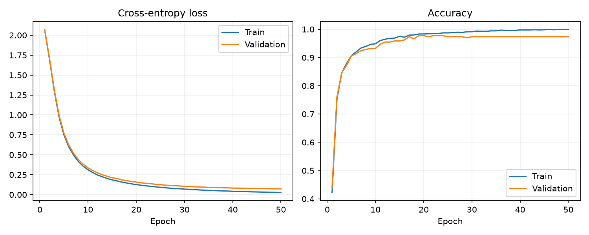
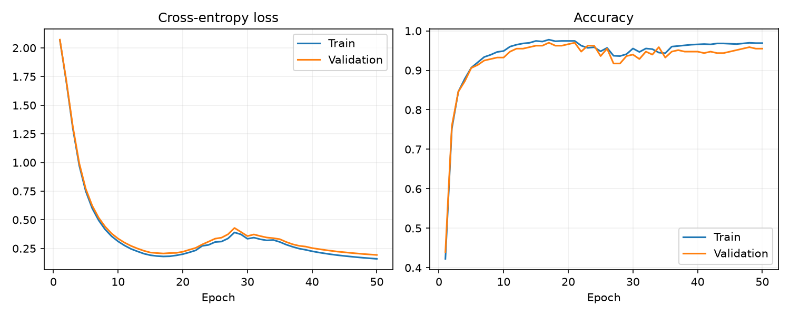
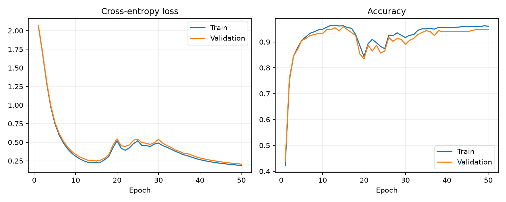

## Setup

Python 3.10+ (validated with Python 3.12). From this directory:

```bash
uv sync --extra dev
uv run pytest -q
```

If the system uses enterprise certificate authorities, use
`uv --system-certs sync --extra dev`; keep certificate verification enabled.
The resolved `uv.lock` is included. Alternatively create a venv and install
`python -m pip install -e '.[dev]'`.

## Run

```bash
# Numerical derivatives only
uv run pytest tests/test_gradients.py -q
# All tests, including masks, optimizer lifecycle and learning
uv run pytest -q
# Dense baseline
uv run python -m train.run --method dense
# Progressive sensitivity-based pruning
uv run python -m train.run --method saliency --sparsity 0.9
# Magnitude baseline
uv run python -m train.run --method magnitude --sparsity 0.9
# Full 27-run sweep at the default settings (choose a new empty output folder)
uv run python -m train.sweep --config configs/default.json --output results/new_sweep
# Benchmark a saved checkpoint
uv run python -m train.benchmark --checkpoint results/new_sweep/saliency_s0.9_seed0/model.npz
```

`run` also accepts `--epochs`, `--seed`, `--config`, and `--output`.
Existing nonempty experiment directories are not overwritten. Use a new output
path for a rerun. Training writes resolved config, per-epoch history, summary,
learning-curve PNG and an inference-only NPZ checkpoint. Optimizer state is not
saved, so this checkpoint is not a training-resume artifact.

## A tiny inspectable example

```bash
uv run python examples/inspect_step.py
```

Prints the forward value, exact gradients, Adam update, pruning state and revival age.
See `VALIDATION.md` for actual local test and training results.

## Architecture

```text
engine/    Tensor graph, local derivatives, finite differences
nn/        Parameters, layers, activations, and loss
prune/     Scores, schedule, budget controller, and sparse inference
train/     Data, loop, checkpoints, CLI, sweeps, and benchmarks
optim/     Adam, masks, update age, and revival resets
tests/     Correctness and training assertions
configs/   Experiment settings
results/   Measurements, plots, and checkpoints
```

Read `ARCHITECTURE.md` for a detailed walkthrough and `DESIGN.md` for mathematical
contracts, limitations and production considerations.

## Restrictions and data

The training task is handwritten-digit classification. It uses scikit-learn's
built-in **Digits** dataset: 1,797 grayscale 8×8 handwritten digit images (digits
0–9). This is a small MNIST-style dataset, but it is **not the MNIST dataset**
(which contains 28×28 images). Scikit-learn is used exclusively to load these
bundled images. Splitting,
normalization, batching and accuracy use NumPy. No external autodiff, pruning,
optimizer or neural-network library is used. Matplotlib renders plots; pytest
runs tests. Gradient checking uses finite differences; training uses our reverse
mode engine, never numerical gradients.

Digits are divided by 16 and split per class using a fixed seed. Fractions are
70/15/15, with integer rounding per class. The network is 64 → 64 → 32 → 10,
with ReLU then tanh on its hidden layers:
6,464 prunable weights and 106 unpruned biases. Warm-up/ramp/fine-tuning is
20/60/20 percent of training, with pruning at epoch boundaries.

The saved 50-epoch learning curves below show training and validation loss and
accuracy for three runs on the same fixed split. **Dense** is the unpruned Part 2
baseline. **Saliency-pruned** progressively removes connections using the
gradient-based importance score; **magnitude-pruned** removes the smallest
weights. Both pruning runs target 90% sparsity and finish at 90.006% (646 of
6,464 weights active). The curves, epoch histories, summaries and inference
checkpoints are saved in the linked folders.

| Run | Test accuracy | Test loss | Learning curve |
|---|---:|---:|---|
| Dense baseline | 96.77% | 0.1361 | [`dense_seed0`](results/part2_training/dense_seed0/learning_curve.png) |
| Saliency-pruned, 90% target | 96.42% | 0.2054 | [`saliency_90_seed0`](results/part3_pruning/saliency_90_seed0/learning_curve.png) |
| Magnitude-pruned, 90% target | 95.34% | 0.2429 | [`magnitude_90_seed0`](results/part3_pruning/magnitude_90_seed0/learning_curve.png) |







## Evidence boundaries

`results/basic_*` contains single-seed 30-epoch validation runs. The matched
three-seed, 50-epoch sweep and its raw per-run metrics are in
`results/part4_evidence/`; its small seed count supports a limited comparison,
not a broad claim of method superiority. The 90% sparse benchmark reports fewer
weight MACs and a smaller array payload, but its Python sparse path is slower
than dense inference on the measured machine. Sparse MAC counts exclude
bias/activation work. Array payload bytes include index arrays but exclude
Python object overhead. Training remains dense.

## Scope and known limitations

- The comparative sweep uses three matched seeds and one fixed test split. Its
  claim is intentionally limited; use more seeds and an untouched final test set
  before making a broad superiority claim.
- The Python sparse inference path reduces weight MACs and array payload but was
  slower than dense inference on the measured machine.
- Automatic regrowth, training checkpoint resume, GPU execution, and a production
  inference service are outside this implementation. See `DESIGN.md` and
  `VALIDATION.md` for the decisions, evidence, and limitations.
