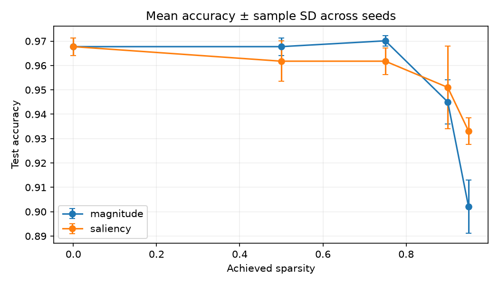

# Validation and Part 4 evidence

## Correctness checks

The previously recorded full correctness run reported 64 passing tests. For the
mixed-activation changes, checks passed for tanh forward/backward against finite
differences, sparse/dense output equivalence, and checkpoint activation roundtrip.
`compileall` also passed. The full pytest suite could not be rerun because pytest
is absent from the local environment.

## Matched sparsity sweep

The default configuration was freshly rerun for 50 epochs at seeds 0, 1, and 2,
using ReLU followed by tanh in the two hidden layers. This is 27 runs: one dense
baseline per seed, plus magnitude and saliency pruning at 50%, 75%, 90%, and 95%
target sparsity. All runs use the same fixed, class-stratified
1,252/266/279 train/validation/test split. The regenerated evidence is under
`results/part4_evidence/`:

- `raw_results.json`: all 27 per-run configurations and test metrics.
- `pareto.png`: mean test accuracy versus achieved sparsity, with sample-standard-
  deviation error bars across the three seeds.
- `paired_comparison.json`: per-seed saliency-minus-magnitude accuracy differences
  and their mean/sample standard deviation at each target.
- Per-run directories: resolved configuration and per-epoch history. Repeated
  per-run summaries, plots, and checkpoints are omitted from this sweep folder to
  keep the upload below GitHub's 100-file batch limit; aggregate metrics and the
  Pareto plot are retained. The three representative learning curves are saved
  separately below. The seed-0 90% saliency checkpoint is retained for the
  benchmark artifact.



### Learning curves

These are separate 50-epoch, seed-0 training runs on the same fixed handwritten-
digit split. The dense run is the unpruned baseline. The saliency run prunes by
the gradient-based importance score; the magnitude run prunes the smallest
weights. Both pruned runs target 90% sparsity and achieved 90.006% (646 active
weights out of 6,464). Each plot shows both training and validation loss and
accuracy. Raw per-epoch histories, summaries, configs, and checkpoints for these
three representative runs are in their corresponding run folders.

| Run | Test accuracy | Test loss | Plot |
|---|---:|---:|---|
| Dense baseline | 96.77% | 0.1361 | `results/part2_training/dense_seed0/learning_curve.png` |
| Saliency-pruned, 90% target | 96.42% | 0.2054 | `results/part3_pruning/saliency_90_seed0/learning_curve.png` |
| Magnitude-pruned, 90% target | 95.34% | 0.2429 | `results/part3_pruning/magnitude_90_seed0/learning_curve.png` |


| Target sparsity | Method | Achieved sparsity | Active weights | Mean test accuracy ± sample SD |
|---:|---|---:|---:|---:|
| 0% | Dense | 0.000% | 6,464 | 96.77% ± 0.36 pp |
| 50% | Magnitude | 50.000% | 3,232 | 96.77% ± 0.36 pp |
| 50% | Saliency | 50.000% | 3,232 | 96.18% ± 0.83 pp |
| 75% | Magnitude | 75.000% | 1,616 | 97.01% ± 0.21 pp |
| 75% | Saliency | 75.000% | 1,616 | 96.18% ± 0.55 pp |
| 90% | Magnitude | 90.006% | 646 | 94.50% ± 0.90 pp |
| 90% | Saliency | 90.006% | 646 | 95.10% ± 1.69 pp |
| 95% | Magnitude | 95.003% | 323 | 90.20% ± 1.10 pp |
| 95% | Saliency | 95.003% | 323 | 93.31% ± 0.55 pp |

At 90%, the paired saliency-minus-magnitude differences for seeds 0, 1, and 2
were +1.08, -1.43, and +2.15 percentage points. Their mean is +0.60 pp and
sample SD is 1.84 pp. One of the three paired differences is negative, and the
small seed count does not establish general superiority or statistical significance.
Because the same held-out test split is reported across several methods and
targets, treat this sweep as comparative challenge evidence rather than a final
one-time test of an independently selected model. A stricter study would choose
the method and target using validation data, then evaluate the selected model once
on a separate untouched test set.

**Falsifiable claim supported by these runs:** With this fixed digits split and
50-epoch mixed-activation configuration, at 90.006% achieved sparsity, saliency
pruning has mean test accuracy of 95.10% over seeds 0–2, versus 94.50% for matched
magnitude pruning, a paired mean advantage of 0.60 percentage points. Repeating these
matched runs can confirm or refute the claim. It is limited to this dataset,
split, configuration, and three seeds.

## Sparse cost measurement

The sparse-aware benchmark ran on the seed-0 90% saliency checkpoint with batch
size 32, five warmups, and 30 timed repetitions. It checks dense and sparse output
equivalence before timing. Results are in
`results/part4_evidence/saliency_s0.9_seed0/benchmark.json`:

- Weight MACs per example: 6,464 dense versus 646 sparse (90% fewer).
- Array payload: 52,560 bytes dense versus 11,184 bytes sparse, including indices
  (about 78.7% fewer bytes; excludes Python object overhead).
- Median latency: 0.015208 ms dense versus 0.126125 ms sparse (the sparse path is
  about 8.3 times slower on this machine).

The sparse forward path skips inactive connections, while the dense comparison
uses a pre-masked dense matrix. Thus the MAC and array reductions are real, but
this Python implementation does not demonstrate a wall-clock speedup. MAC counts
exclude bias and activation operations; latency is hardware- and implementation-
dependent.

## Reproduce

```bash
uv run python -m train.sweep --config configs/default.json --output results/new_sweep
uv run python -m train.benchmark \
  --checkpoint results/new_sweep/saliency_s0.9_seed0/model.npz \
  --output results/new_sweep/saliency_s0.9_seed0/benchmark.json
```

Use a new empty output directory; the sweep intentionally refuses to overwrite
existing evidence.
